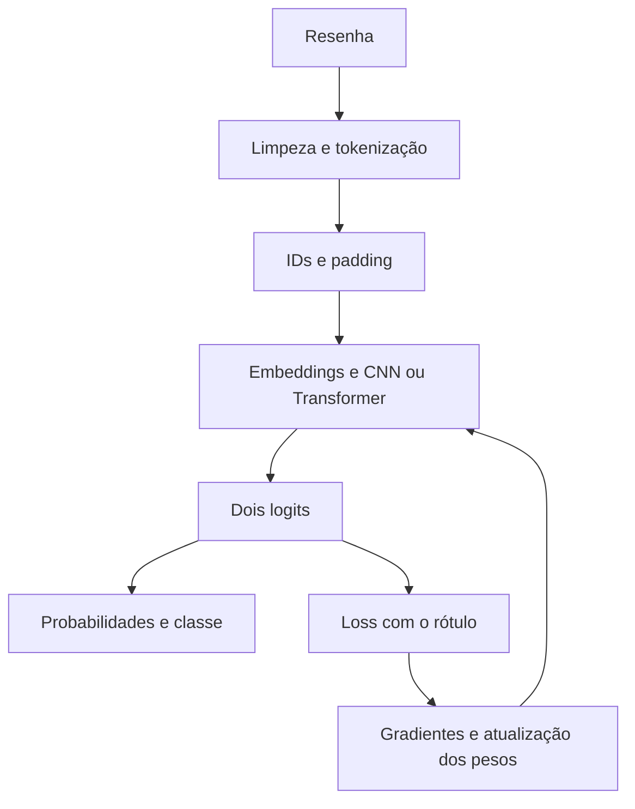

<p align="center">
  
</p>

<p align="center">
  <strong>Projeto MAE5920 · Introdução a Deep Learning</strong><br>
  Nestor · Letícia · Gabriel
</p>

<p align="center">
  <a href="output/pdf/relatorio_seminario.pdf"><strong>Relatório do seminário</strong></a> ·
  <a href="output/pdf/slides_15_min.pdf">Slides de 15 min</a> ·
  <a href="notebooks/seminario_completo.ipynb">Notebook único</a> ·
  <a href="docs/RESULTADOS.md">Tabelas de resultados</a>
</p>

**Como um texto vira uma classificação, o que o treinamento modifica e o que
acontece quando alteramos uma ativação interna?** Estudamos essas perguntas com
resenhas de filmes do IMDb. A tarefa principal tem duas classes: sentimento
negativo ou positivo. As extensões relacionam o experimento à disciplina:
tokenização, CNNs, transferência com Transformers, otimização, regularização,
double descent e steering de um modelo de linguagem.

O relatório da turma e os slides de 15 minutos têm fontes editáveis em LaTeX.
[Material do seminário, roteiro de fala e demonstração](seminario/README.md).

## Comece por aqui

**O [notebook único do seminário](notebooks/seminario_completo.ipynb) é o roteiro
para estudar com o grupo, do começo ao fim.** Contém 15 capítulos, arquitetura e
treinador escritos no próprio arquivo, parâmetros, tokenização, gráficos,
exemplos e resultados identificados. Está executado e pode ser lido no GitHub,
sem instalar nada. Você pode compartilhar somente esse `.ipynb`: suas evidências
de leitura estão em um anexo interno. Veja [como abrir e executar](docs/NOTEBOOK_UNICO.md).

| Se você quer… | Abra |
|---|---|
| Entender o trabalho pela primeira vez | [Guia do projeto](docs/GUIA_COMPLETO.md), depois o [notebook único](notebooks/seminario_completo.ipynb) |
| Encontrar acurácia, F1 macro e loss juntos | [Resultados por estudo](docs/RESULTADOS.md) · [CSV consolidado](results/resumo_metricas.csv) |
| Preparar a apresentação | [Slides de 15 min](output/pdf/slides_15_min.pdf) · [roteiro](seminario/roteiro.md) · [fontes editáveis](seminario/) |
| Ler arquiteturas, hiperparâmetros e BPE | [Relatório CNN e encoders](output/pdf/relatorio_cnn_encoders.pdf) |
| Estudar intervenções nas ativações | [Relatório Qwen3-8B](relatorio_qwen3.pdf) · seção 11 do notebook único |
| Conferir ou repetir as execuções | [Guia de reprodução](docs/REPRODUCAO.md) |

## O que fizemos

| Etapa | Pergunta e implementação | Onde aprofundar |
|---|---|---|
| Classificação original | TF-IDF + regressão logística, CNN do zero e BERT com ajuste completo; avaliação, calibração e análise de erros | [Relatório IMDb](relatorio_imdb.pdf) · [protocolo original](docs/EXPERIMENTO_ORIGINAL.md) |
| Qwen3-8B congelado | Classificar comparando escores de dois tokens de rótulo, sem treinar seus pesos | [Protocolo Qwen](QWEN_EXPERIMENTO.md) |
| Intervenções nas ativações | Descobrir direções, deslocar estados internos e observar a mesma entrada sem steering e nos dois sentidos; controles e falhas preservados | [Relatório Qwen](relatorio_qwen3.pdf) · [galeria com os 64 trios](relatorio_qwen3.html) |
| Mecanismos da disciplina | 51 treinos de MLP: otimizadores, profundidade, resíduos e regularização; inicialização e 880 condições sintéticas de capacidade | [Suplemento](output/pdf/relatorio_disciplina.pdf) · [guia dos mecanismos](docs/CONEXOES_DISCIPLINA.md) |
| CNNs e Transformers | 42 treinos de CNN, 27 cabeças sobre encoders congelados e 18 ajustes completos de BERT, DistilBERT e ModernBERT | [Relatório](output/pdf/relatorio_cnn_encoders.pdf) · [protocolo e grades](docs/PROTOCOLO_SEQUENCIAS.md) |
| Palavras versus BPE | BPE aprendido só nos textos de treino, sem rótulos; três novas CNNs comparadas a três checkpoints por palavras | [Protocolo BPE](docs/PROTOCOLO_BPE.md) |
| Testes com as CNNs congeladas | Permutação de palavras, 2.000 frases rotuladas fora do IMDb e dois comentários ambíguos do YouTube | [Material e evidências do seminário](seminario/README.md) |

São **90 treinos neurais na extensão sequencial**, além dos 51 treinos do
suplemento MLP. Esses totais descrevem estudos diferentes; checkpoints
reutilizados e linhas repetidas nas tabelas não representam novos treinos.

## Como o notebook ensina

O percurso acompanha limpeza, tokens, IDs, padding e embeddings. Mostra a classe
`TextCNN`, as dimensões dos tensores, a conta dos **2.714.502 parâmetros** da CNN
didática e os passos `forward`, entropia cruzada, `backward`, clipping e atualização
do otimizador. Seguem grades de hiperparâmetros, curvas, BPE, encoders e exemplos
de predição. Os capítulos finais conectam o código ao livro e mostram o steering.



Ao executar todas as células, há três tipos de conteúdo identificados:

- **Exercícios pequenos em CPU:** operações, gradientes, treino de demonstração e hooks.
- **Resultados reais preservados:** curvas, previsões e gerações dos experimentos concluídos.
- **Treino completo opcional:** fluxo das seis CNNs, desligado por padrão e dependente da restauração do corpus.

O caminho padrão não baixa pesos do BERT ou do Qwen e não requer GPU. A direção
é reconstruída das ativações de treino incluídas no arquivo; as gerações grandes
são lidas dos resultados salvos. Os quatro notebooks específicos continuam em
[notebooks/](notebooks/) para consultas detalhadas.

## Como ler os resultados

**Acurácia, F1 macro e loss estão nas [tabelas de resultados](docs/RESULTADOS.md).**
Loss significa entropia cruzada, também chamada de log loss; menor é melhor.
Cada tabela informa a amostra avaliada e se o número é de uma execução ou a média
de três sementes.

O teste oficial original tem 25 mil resenhas. As extensões MLP, CNN/encoders e BPE
usam auditorias internas distintas de 2.048 exemplos, retiradas do antigo treino
limpo. A avaliação externa das CNNs usa 1.000 frases de Amazon e 1.000 de Yelp.
Compare modelos **dentro do mesmo estudo**, usando a coluna `estudo` no CSV.
[Divisões do IMDb](docs/GUIA_COMPLETO.md) · [Avaliação externa](seminario/README.md#avaliação-fora-do-imdb).

Os experimentos permitem discutir que cobertura de vocabulário não garante ganho
de acurácia, que o regime de ajuste muda a comparação entre encoders e que taxa,
profundidade e regularização alteram as trajetórias. Double descent aparece na
regressão sintética; não foi estabelecido na CNN do IMDb. O steering pode alterar
a saída e apresentar falhas de conteúdo e estilo. Demonstrar superioridade sobre
prompting não é o objetivo; o juiz automático usa o próprio Qwen, sem anotação
humana independente.

## Executar e conferir

Os materiais atualizados ficam na página inicial. As versões empacotadas
estão em [Releases](https://github.com/costaleirbag/projeto-mae5920/releases).
Para executar numa cópia local, com Python 3.11 ou posterior:

```bash
git clone https://github.com/costaleirbag/projeto-mae5920.git
cd projeto-mae5920
python3 -m venv .venv
source .venv/bin/activate
python -m pip install -e .

# Confira a versão publicada antes de reexecutar ou alterar arquivos.
python tools/verify_publication.py
python verify_seminar_notebook.py
python tools/build_results_overview.py --check
python -m pytest -q

# Executa exercícios em CPU e lê as evidências salvas.
python execute_notebook.py --notebook notebooks/seminario_completo.ipynb
```

Reexecutar pode mudar tempos, metadados e hashes. Preserve a versão baixada e use
uma cópia de trabalho. O notebook tem **45 células executadas, 16 figuras e 476
verificações**. Seu certificado registra execução fora do repositório, sem GPU e
com conexões de sockets Python bloqueadas. Isso verifica o caminho didático;
não significa repetir todos os treinos grandes.

Para instalar somente o necessário ao notebook, restaurar dados, conferir os
experimentos ou treinar novamente, siga o [guia de reprodução](docs/REPRODUCAO.md).

## Mapa do repositório

```text
notebooks/seminario_completo.ipynb  Roteiro único, autocontido e executado
notebooks/                        Quatro notebooks específicos preservados
docs/GUIA_COMPLETO.md              Explicação do projeto e mapa do código
docs/RESULTADOS.md                 Acurácia, F1 macro e loss por estudo
docs/REPRODUCAO.md                 Leitura, verificações e novos treinos
output/slides/                    Apresentação editável
output/pdf/                       Relatórios CNN/encoders e mecanismos
relatorio_imdb.pdf                 Estudo original
relatorio_qwen3.pdf                Qwen e steering
src/imdb_lab/                     Modelos, treinamento e análises
results/                          Curvas, previsões, gerações e manifestos
tests/                            Invariantes matemáticos e de implementação
tools/                            Construção, reprodução e publicação
```

O corpus preparado e os checkpoints treinados ficam fora do Git. As evidências de
leitura estão incluídas; o [guia de reprodução](docs/REPRODUCAO.md) descreve os
complementos para auditar pesos ou treinar novamente. A versão histórica
[v1.0.0](https://github.com/costaleirbag/projeto-mae5920/releases/tag/v1.0.0)
preserva a primeira entrega.

## Fontes e autoria

Dados: [Large Movie Review Dataset, Maas et al.](https://ai.stanford.edu/~amaas/data/sentiment/),
pela distribuição [stanfordnlp/imdb](https://huggingface.co/datasets/stanfordnlp/imdb).
Modelos: [BERT](https://huggingface.co/google-bert/bert-base-uncased),
[DistilBERT](https://huggingface.co/distilbert/distilbert-base-uncased),
[ModernBERT](https://huggingface.co/answerdotai/ModernBERT-base),
[Qwen3-8B](https://huggingface.co/Qwen/Qwen3-8B) e
[MiniLM](https://huggingface.co/sentence-transformers/all-MiniLM-L6-v2).
Steering: [Beaglehole et al.](https://arxiv.org/abs/2502.03708) e
[implementação dos autores](https://github.com/dmbeaglehole/neural_controllers).
Referências ao livro e aos slides estão no [guia dos mecanismos](docs/CONEXOES_DISCIPLINA.md)
e nas [notas da apresentação](docs/NOTAS_APRESENTACAO.md).

Implementação educacional de Nestor, Letícia e Gabriel. Dados e modelos mantêm seus
termos de uso e atribuição. As leituras qualitativas assistidas por IA são identificadas;
não houve anotação humana independente. Consulte o [escopo da publicação](docs/PUBLICACAO.md),
o [dicionário dos resultados](DATA_DICTIONARY.md) e a [rubrica de revisão humana](AVALIACAO_HUMANA.md).
