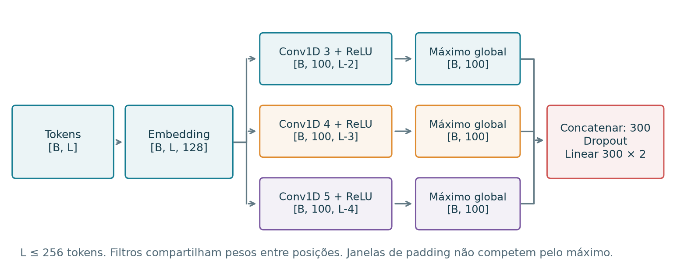
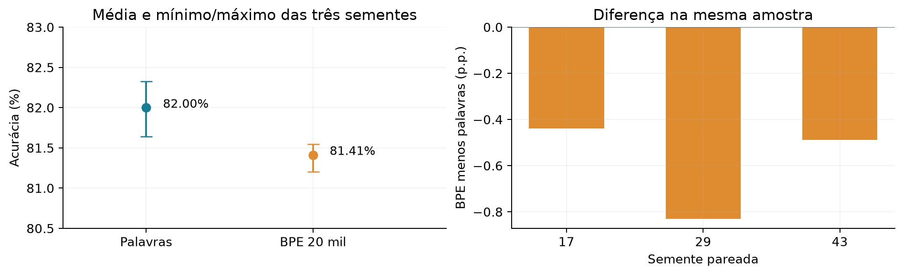
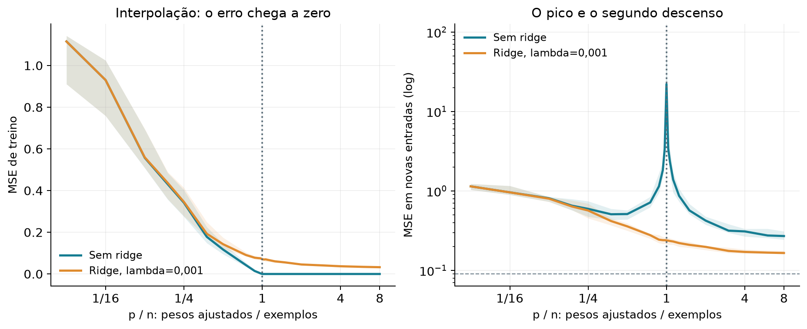

<p align="center">
  
</p>

<p align="center">
  <strong>Projeto MAE5920 · Introdução a Deep Learning</strong><br>
  Nestor · Letícia · Gabriel
</p>

<p align="center">
  <a href="notebooks/seminario_completo.ipynb"><strong>Notebook único do seminário</strong></a> ·
  <a href="output/slides/seminario_mae5920.pptx">Slides editáveis</a> ·
  <a href="output/pdf/relatorio_cnn_encoders.pdf">CNN e encoders</a> ·
  <a href="output/pdf/relatorio_disciplina.pdf">Mecanismos e double descent</a> ·
  <a href="relatorio_qwen3.pdf">Qwen3 e steering</a> ·
  <a href="notebooks/">Notebooks</a> ·
  <a href="https://github.com/costaleirbag/projeto-mae5920/releases/latest">Downloads</a>
</p>

Este trabalho compara modelos de classificação de sentimento em resenhas de
filmes, estuda intervenções nas ativações de um modelo de linguagem congelado
e acrescenta experimentos ligados ao material da disciplina: otimização,
profundidade, inicialização, regularização e double descent.

**Para estudar e mostrar ao grupo do começo ao fim, abra o
[notebook único](notebooks/seminario_completo.ipynb).** Ele reúne os temas em uma
sequência didática, com arquitetura e treinador visíveis, tokenização, conta dos
parâmetros, exercícios em CPU e resultados reais identificados. Os dados de leitura,
tokenizers e estados selecionados estão dentro do próprio `.ipynb`: você pode
compartilhar só esse arquivo. [Como usar e o que ele executa](docs/NOTEBOOK_UNICO.md).

**Extensão desta branch:** [slides editáveis](output/slides/seminario_mae5920.pptx),
[CNN, BERT e encoders modernos](output/pdf/relatorio_cnn_encoders.pdf),
[notebook dos novos modelos](notebooks/cnn_encoders.ipynb) e
[suplemento de mecanismos](output/pdf/relatorio_disciplina.pdf).
A comparação [palavras versus BPE](docs/PROTOCOLO_BPE.md) está integrada
ao relatório, notebook e aos slides 22–24.
A release v1.0.0 contém a entrega original; os arquivos novos estão nesta branch.

Na extensão com **Qwen3-8B**, a mesma entrada e o mesmo prompt produzem três
saídas: sem steering, com intervenção negativa e com intervenção positiva.
O objetivo é compreender o mecanismo, seus efeitos e suas falhas.

## Comece por aqui

| Material | O que você encontra |
|---|---|
| **[Notebook único, do começo ao fim](notebooks/seminario_completo.ipynb)** | 15 capítulos, 45 células de código executadas, CNN, BPE, encoders, mecanismos da disciplina e Qwen. Autocontido, com código real e exercícios em CPU. |
| **[Slides do seminário](output/slides/seminario_mae5920.pptx)** | Diagramas editáveis, gráficos nativos, notas de fala e material de apoio. |
| **[CNN e encoders modernos](output/pdf/relatorio_cnn_encoders.pdf)** | Arquiteturas, otimização da CNN, encoders congelados e ajuste completo de BERT, DistilBERT e ModernBERT. |
| [Notebook CNN e encoders](notebooks/cnn_encoders.ipynb) | Resultados de 87 treinos, hiperparâmetros, exemplos comuns e leitura dos filtros da CNN. Executado, sem exigir GPU para leitura. |
| [Galeria CNN e encoders em HTML](relatorio_cnn_encoders.html) | Diagramas, curvas e todos os exemplos sintéticos, em arquivo autocontido. |
| [Protocolo palavras versus BPE](docs/PROTOCOLO_BPE.md) | Tokenizer aprendido só no treino, três novas CNNs, controles e resultados em uma nova auditoria. |
| **[01 · Relatório principal — IMDb](relatorio_imdb.pdf)** | TF-IDF + regressão logística, CNN, BERT, análise de erros e primeira intervenção nas ativações. |
| **[02 · Relatório — Qwen3-8B e steering](relatorio_qwen3.pdf)** | Modelo congelado, construção das direções e exemplos completos da intervenção nos dois sentidos. |
| **[03 · Do modelo aos mecanismos](output/pdf/relatorio_disciplina.pdf)** | Suplemento com experimentos e referências ao livro e aos slides. |
| [Notebook das conexões com a disciplina](notebooks/conexoes_disciplina.ipynb) | Curvas, controles e reconstruções dos novos experimentos, sem repetir os treinos. |
| [Galeria HTML da extensão](relatorio_disciplina.html) | Gráficos autocontidos e tabelas da auditoria interna; baixe e abra no navegador. |
| [Notebook dos modelos](notebooks/experimentos_imdb.ipynb) | Resultados, figuras e verificações do experimento principal; já executado. |
| [Notebook Qwen3 e steering](notebooks/qwen3_8b_steering.ipynb) | Reconstrução das direções, exemplos e diagnósticos; já executado e pode ser reexecutado sem GPU. |
| [Galeria Qwen em HTML](relatorio_qwen3.html) | Todas as 64 fontes, cada uma com as três saídas da demonstração. Baixe o arquivo e abra no navegador. |
| [Relatório principal em HTML](relatorio.html) | Versão ampliada, com figuras e exemplos. Baixe e abra no navegador. |

Para estudar em grupo, comece pelo **notebook único**. Para a fala do seminário,
use os **slides** e o relatório **CNN e encoders**.
O suplemento de mecanismos acrescenta MLPs, inicialização e double descent.
Os dois relatórios originais apresentam a base do projeto e o steering.
Os notebooks e resultados permitem conferir como chegamos até eles.
O GitHub exibe os notebooks executados; o seletor interativo do Qwen funciona
em um ambiente Jupyter. A galeria HTML também permite percorrer os casos.

## CNN, BERT e encoders modernos

A nova bateria usa texto sequencial: **42 treinos de CNN**, **27 cabeças
lineares sobre encoders congelados** e **18 ajustes completos** de BERT-base,
DistilBERT e ModernBERT-base. Todas as condições neurais usam três sementes.
Os encoders partem de pesos públicos de pré-treinamento, sem ajuste prévio
no IMDb. No ajuste completo, todas as camadas recebem gradientes.

| Bloco | O que testamos | Controle |
|---|---|---|
| Otimização da CNN | SGD, momentum e Adam, três taxas por método | Mesmos pesos, minibatches e doze épocas por semente |
| Arquitetura da CNN | Janelas 3, 5 e 3/4/5; 32 ou cem filtros | Embedding 128 e taxa de Adam reutilizada |
| Dropout da CNN | 0; 0,5; 0,8 | Mesma arquitetura e partida |
| Encoder congelado | BERT, DistilBERT, ModernBERT; três taxas | Só a cabeça linear de 1.538 parâmetros aprende |
| Ajuste completo | Os três encoders, duas taxas | Três épocas, AdamW e seleção por validação |

Os modelos recebem o mesmo prefixo de até **128 palavras**. As redes
sequenciais limitam a entrada a 256 tokens; o TF-IDF usa o prefixo completo.
Usamos 6.144 resenhas de treino e 1.536 de
validação. A **nova auditoria interna com 2.048 resenhas** exclui todos os
papéis do estudo MLP. Taxas, épocas e pesos ficam congelados antes de abrir
essa auditoria. O teste oficial não foi consultado novamente.



Acurácia na nova auditoria interna, média das três sementes:

| Encoder | Congelado | Ajuste completo |
|---|---:|---:|
| BERT-base | 84,52% | 88,31% |
| DistilBERT | 83,35% | 86,80% |
| ModernBERT-base | 81,30% | 91,24% |

Controles no mesmo recorte: CNN + Adam **81,95%**;
TF-IDF + logística **83,30%** (uma execução determinística).
A ordenação entre encoders muda conforme o regime de ajuste.

As receitas congelada e completa têm orçamentos e otimizadores diferentes.
Entre famílias, pré-treinamento, tokenização e escala também mudam. As
comparações descrevem este protocolo; não isolam arquitetura como única
causa nem provam superioridade universal. Os tempos incluem o encoder
congelado na inferência e registram a extração dos vetores separadamente.

[Protocolo e grades](docs/PROTOCOLO_SEQUENCIAS.md) ·
[Reproduzir](docs/REPRODUCAO_SEQUENCIAS.md) ·
[Notas dos slides](docs/NOTAS_APRESENTACAO.md) ·
[Resultados em CSV](results/sequences/comparison.csv)

```bash
python verify_sequences.py
python execute_notebook.py --notebook notebooks/cnn_encoders.ipynb
```

## Aprender BPE melhora esta CNN?

Treinamos um **BPE de caracteres com 20 mil tokens** usando somente os textos
de treino, sem rótulos. Depois congelamos suas regras e treinamos três CNNs do
zero. O tokenizer por palavras e o BPE compartilham a limpeza por regex.
Embedding 128, janelas 3/4/5, cem filtros por janela, Adam 0,001, doze épocas,
minibatches e matrizes iniciais permanecem iguais. Ambos os modelos têm
**2.714.502 parâmetros**. Uma janela passa a contar subpalavras no BPE.

Usamos os três checkpoints por palavras e os três novos checkpoints BPE em
**outra auditoria interna de 2.048 resenhas**, reservada antes do treino e
liberada após o congelamento. Ela exclui os papéis dos dois estudos didáticos
anteriores. O teste oficial não foi reaberto.

| Representação | Acurácia média | Tokens UNK na nova auditoria | Tokens médios por resenha |
|---|---:|---:|---:|
| Palavras | 82,00% | 3,27% | 121,3 |
| BPE 20 mil | 81,41% | 0% | 129,1 |

O BPE melhorou a cobertura, mas ficou **0,59 ponto percentual abaixo** na
acurácia média nesta receita fixa. A taxa veio da CNN por palavras, sem novo
ajuste. O resultado permite discutir representação, comprimento e alcance
dos filtros. Não prova que BPE seja inferior em geral. Estes números usam
uma amostra diferente da tabela dos encoders acima.



O [relatório CNN e encoders](output/pdf/relatorio_cnn_encoders.pdf) e o
[notebook](notebooks/cnn_encoders.ipynb) mostram a tokenização real, as uniões
passo a passo, curvas de treino e diferenças pareadas. Os
[slides 22–24](output/slides/seminario_mae5920.pptx) acrescentam esse conteúdo.
São **90 treinos neurais** na extensão sequencial: os 87 anteriores e três
novos BPE. Os seis checkpoints da comparação reproduziram exatamente seus
logits em um segundo processo; 18 conjuntos de métricas foram conferidos.

```bash
python run_bpe.py verify --device cpu
```

## Conexões com o material da disciplina

| Tema | O que varia | Controle principal |
|---|---|---|
| Adam, SGD e momentum | Algoritmo e três taxas candidatas por método | Mesma MLP, pesos iniciais, minibatches e orçamento |
| Profundidade e atalhos | 1/4/12 camadas, soma identidade e escala residual | As três redes de 12 camadas têm parâmetros e partida iguais |
| Inicialização | Escala He multiplicada por 0,1, 1 ou 3 | Cadeia ReLU sintética, entradas e matrizes gaussianas iguais |
| Overfitting | Dropout, L2 explícita e parada por validação | 512 resenhas supervisionadas e mesma MLP |
| Double descent | Coeficientes de saída e ridge | Regressão sintética, ReLU oculta congelada e vinte sementes |

No suplemento com MLPs, são **51 treinos no IMDb**, três sementes, 42 checkpoints na auditoria interna
e **880 condições sintéticas**. Os 6.144/1.536/2.048 exemplos da extensão vêm
somente do antigo treino limpo; o teste oficial não foi consultado novamente.
Vocabulário, IDF, SVD e padronização usam somente os 6.144 exemplos de ajuste.
As redes densas compartilham essas entradas; isto não é um novo ranking CNN/BERT/Qwen.



O double descent aparece no exemplo sintético, identificado separadamente;
não foi estabelecido na CNN do IMDb. Todas as sementes e valores extremos são
preservados. Os gráficos são descritivos e não estabelecem superioridade universal.
O [guia das conexões](docs/CONEXOES_DISCIPLINA.md) explica os controles e referências.
Uma divergência de precisão entre treino e avaliação foi detectada e corrigida;
a repetição preservou exatamente os parâmetros aprendidos e está documentada.

```bash
python verify_didactic.py
python execute_notebook.py --notebook notebooks/conexoes_disciplina.ipynb
```

## Experimentos originais

### 1. Como os modelos classificam resenhas?

Resultados no teste oficial do IMDb, com **25.000 avaliações**:

| Modelo | Ajuste dos pesos neste projeto | Acurácia | F1 macro |
|---|---|---:|---:|
| TF-IDF + regressão logística | Sim, no treino | 90,144% | 90,144% |
| CNN | Sim, no treino | 86,784% | 86,782% |
| BERT-base | Ajuste integral | 90,944% | 90,941% |
| Qwen3-8B | Pesos congelados | 95,260% | 95,260% |

O Qwen classifica comparando os escores dos tokens `negative` e `positive`.
Não acrescentamos uma cabeça de classificação nem ajustamos seus pesos.
A calibração de probabilidades é uma etapa separada.

**A comparação tem limites:** o Qwen recebe até 768 tokens da fonte e o BERT,
192 WordPieces; o baseline recebe o texto completo. A extensão com Qwen é
exploratória e reutiliza um teste já examinado. Esses números não isolam
o efeito da arquitetura ou do tamanho do modelo.

Fontes dos números: [modelos principais](results/comparison.csv) e
[Qwen](results/qwen/classification/metrics.json).

### 2. O que muda quando deslocamos uma ativação?

Na demonstração atual, capturamos estados internos de **128 enredos de treino**,
cada um apresentado com uma instrução positiva e outra negativa. No bloco 28,
a diferença entre as médias dos dois grupos define uma direção unitária:

```text
v = normalizar(média dos estados positivos − média dos estados negativos)
h' = h + α · escala · v             α ∈ {−2, 0, +2}
```

Na geração de teste, o prompt comum pede os campos `FACT` e `REVIEW`, sem
indicar um sentimento-alvo. A intervenção começa após o marcador `REVIEW:`
gerado pelo modelo. Os pesos continuam congelados. O texto factual anterior
ao marcador permanece idêntico entre as três condições.

A direção original, obtida por **RFM/AGOP** a partir de 512 resenhas rotuladas,
também está preservada e é reconstruída no notebook. São procedimentos
distintos; a direção escolhida para a demonstração atual é a diferença de médias.

Após congelar a configuração na validação, avaliamos 64 novas fontes de
geração: 32 resenhas reais e 32 enredos sintéticos, em 11 condições
(*704 saídas*, incluindo controles aleatórios). Outras 160 saídas reavaliam
as fontes da rodada anterior. Todas as saídas consolidadas são preservadas.

O juiz automático reconheceu os dois sentidos-alvo em **55/64 fontes**.
Esse resultado é um diagnóstico do próprio Qwen sem intervenção, sem uma
referência humana independente. Há falhas de estilo e uma invenção clara de
cenário preservada no relatório. Prefixo factual idêntico não garante que
toda a saída esteja correta. Demonstrar superioridade sobre prompting
**não é o objetivo do trabalho**.

Detalhes: [protocolo Qwen](QWEN_EXPERIMENTO.md),
[seleção congelada](results/qwen_improved/selection_frozen.json) e
[verificação da rodada atual](results/qwen_improved/verification.json).

## Explorar e reproduzir

**Para ler**, abra os PDFs ou os notebooks no GitHub. O
[pacote da entrega](https://github.com/costaleirbag/projeto-mae5920/releases/latest)
reúne o material para download. Não é preciso carregar o Qwen.

**Para reexecutar o notebook didático do Qwen**, use Python 3.11 ou posterior:

```bash
git clone https://github.com/costaleirbag/projeto-mae5920.git
cd projeto-mae5920
python3 -m venv .venv
source .venv/bin/activate
python -m pip install -e .
python execute_notebook.py --notebook notebooks/qwen3_8b_steering.ipynb
```

O notebook usa os estados selecionados e as saídas salvas, sem GPU e sem
baixar os pesos do Qwen. O arquivo `requirements-lock.txt` registra o ambiente
original; em outra plataforma, a versão disponível de PyTorch pode variar.

**Para conferir os artefatos publicados e o protocolo atual**, antes de
reexecutar notebooks ou regenerar relatórios:

```bash
python tools/verify_publication.py
python verify_qwen_improved.py
python verify_seminar_notebook.py
python -m pytest -q
```

Reexecutar um notebook pode alterar seus metadados e o hash do arquivo;
o manifesto descreve os arquivos publicados. Novas execuções devem ficar
em uma cópia de trabalho.

Para restaurar os dados do IMDb e reexecutar o notebook principal:

```bash
python run.py prepare
python execute_notebook.py --notebook notebooks/experimentos_imdb.ipynb
```

Treinamento, geração com os 8 bilhões de parâmetros, artefatos maiores e
verificações completas estão descritos no
**[guia de reprodução](docs/REPRODUCAO.md)**. A inferência Qwen implementada
requer GPU CUDA; a leitura dos resultados não requer.

## Mapa do repositório

```text
.
├── relatorio_imdb.pdf / relatorio.html       # Experimento principal
├── relatorio_qwen3.pdf / relatorio_qwen3.html # Extensão didática atual
├── notebooks/seminario_completo.ipynb       # Roteiro único, autocontido e executado
├── notebooks/                              # Quatro notebooks específicos também preservados
├── src/imdb_lab/                            # Implementação dos modelos e análises
├── tests/                                  # Invariantes científicos e hooks
├── results/                                # Previsões, figuras e saídas consolidadas
│   ├── qwen/                               # Primeira rodada Qwen
│   ├── qwen_improved/                       # Rodada atual e histórico identificado
│   ├── didactic/                           # MLPs e demonstrações sintéticas
│   ├── sequences/                          # CNNs e transferência com encoders
│   └── bpe/                                # Tokenizer aprendido e comparação pareada
├── output/pdf/relatorio_disciplina.pdf      # Suplemento didático
├── output/pdf/relatorio_cnn_encoders.pdf     # CNN, BERT e encoders modernos
├── output/slides/seminario_mae5920.pptx      # Apresentação editável
├── data/manifest.json                      # Origem e auditoria das divisões
├── docs/                                   # Guia completo, reprodução e publicação
└── tools/verify_publication.py              # Integridade da distribuição
```

Os arquivos na raiz são as **versões atuais**. O material didático anterior
permanece em [`previous_didactic/`](results/qwen_improved/previous_didactic/).
O corpus preparado, os checkpoints treinados e caches maiores são tratados
separadamente; veja o guia de reprodução e os downloads da release.

## Documentação e referências

- [Guia completo do experimento](docs/GUIA_COMPLETO.md)
- [Como usar o notebook único](docs/NOTEBOOK_UNICO.md)
- [Conexões com a disciplina](docs/CONEXOES_DISCIPLINA.md)
- [Protocolo CNN e encoders](docs/PROTOCOLO_SEQUENCIAS.md)
- [Reprodução CNN e encoders](docs/REPRODUCAO_SEQUENCIAS.md)
- [Protocolo e reprodução palavras versus BPE](docs/PROTOCOLO_BPE.md)
- [Notas da apresentação](docs/NOTAS_APRESENTACAO.md)
- [Reprodução e ambientes](docs/REPRODUCAO.md)
- [Protocolo Qwen3-8B](QWEN_EXPERIMENTO.md)
- [Dicionário dos dados e resultados](DATA_DICTIONARY.md)
- [Rubrica para revisão humana](AVALIACAO_HUMANA.md)
- [Escopo e integridade da publicação](docs/PUBLICACAO.md)

Dados: [Large Movie Review Dataset — Maas et al.](https://ai.stanford.edu/~amaas/data/sentiment/),
obtidos pela distribuição [`stanfordnlp/imdb`](https://huggingface.co/datasets/stanfordnlp/imdb).
Modelos: [BERT-base](https://huggingface.co/google-bert/bert-base-uncased),
[DistilBERT](https://huggingface.co/distilbert/distilbert-base-uncased),
[ModernBERT-base](https://huggingface.co/answerdotai/ModernBERT-base),
[Qwen3-8B](https://huggingface.co/Qwen/Qwen3-8B) e
[MiniLM](https://huggingface.co/sentence-transformers/all-MiniLM-L6-v2).
Steering: [Beaglehole et al., *Toward universal steering and monitoring of AI models*](https://arxiv.org/abs/2502.03708)
e [implementação dos autores](https://github.com/dmbeaglehole/neural_controllers).

Esta é uma implementação educacional independente. Dados e modelos de
terceiros mantêm seus termos de uso e atribuição. Leituras qualitativas
produzidas com assistência de IA estão identificadas nos resultados;
não houve anotação humana independente.
