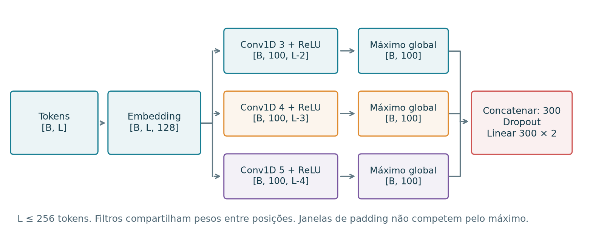

# Entenda o projeto, do texto à intervenção

[Início](../README.md) · [Notebook único](../notebooks/seminario_completo.ipynb) ·
[Resultados](RESULTADOS.md) · [Reprodução](REPRODUCAO.md)

Este guia é para quem chega sem acompanhar as conversas do grupo. O trabalho é de
Nestor, Letícia e Gabriel, para MAE5920 — Introdução a Deep Learning. A aplicação é
**classificar resenhas de filmes em negativas ou positivas**. As extensões usam o
mesmo contexto para observar conceitos da disciplina e intervenções nas ativações.

## Um percurso para estudar e apresentar

Comece pelas seções 1–8 do notebook único: dados, tokenização, CNN, treinamento,
hiperparâmetros, BPE, Transformers e métricas. A seção 12 reúne a comparação original
no teste oficial e a calibração. Isso cobre a linha principal de classificação.

Para ampliar a apresentação, escolha um mecanismo das seções 9–10 ou a demonstração
de steering da seção 11. A seção 15 tem referências ao livro/slides e roteiro de
fala. Os [slides editáveis](../output/slides/seminario_mae5920.pptx) e suas
[notas](NOTAS_APRESENTACAO.md) ajudam a selecionar o que cabe no tempo disponível.
Não é necessário apresentar todos os experimentos para contar uma história completa.

## 1. De onde vêm os dados

Usamos o [IMDb de Maas et al.](https://ai.stanford.edu/~amaas/data/sentiment/),
pela distribuição pública `stanfordnlp/imdb`, com revisão fixada na configuração.
São resenhas em inglês com rótulos 0 (negativo) e 1 (positivo). **Não há classe
neutra**: uma probabilidade próxima de 0,5 indica incerteza do classificador.

O preparo original remove duplicações conforme o protocolo e separa o treino
limpo em 19.823 exemplos de ajuste, 2.478 de validação e 2.478 de calibração.
O teste oficial mantém 25.000 resenhas. O [manifesto original](../data/manifest.json)
registra contagens, IDs e hashes; o [protocolo técnico](EXPERIMENTO_ORIGINAL.md)
explica a limpeza e suas limitações.

| Papel | Para que serve |
|---|---|
| Treino | Aprender vocabulário, transformações e pesos, conforme o modelo |
| Validação | Escolher taxa, época, configuração e intensidade da intervenção |
| Calibração | Ajustar a temperatura das probabilidades no estudo original |
| Teste ou auditoria reservada | Medir a configuração congelada; não escolher o modelo por esse resultado |

As extensões usam subconjuntos do antigo treino limpo: 6.144 exemplos de ajuste,
1.536 de validação e **uma auditoria interna diferente por estudo**, com 2.048
exemplos. MLPs e modelos sequenciais compartilham treino/validação, mas a auditoria
sequencial exclui todos os papéis do estudo MLP. A auditoria BPE exclui os papéis dos
dois estudos anteriores. IDs e exclusões estão nos respectivos manifestos.

Uma auditoria interna é uma avaliação reservada para aquele estudo; não equivale
a um novo benchmark externo. O teste oficial não foi reaberto nessas extensões.
Por isso, dois resultados chamados “CNN” podem diferir sem contradição: podem ter
outra receita, outro comprimento de entrada e outra amostra de avaliação.

## 2. Como o texto vira entrada

**CNN por palavras.** Após limpar o texto, usamos minúsculas e a regex
`[a-z]+(?:'[a-z]+)?|\d+`. Ela extrai palavras, contrações com apóstrofo e números.
O vocabulário é aprendido por contagem apenas no treino: 19.998 entradas mais
`<pad>` (0) e `<unk>` (1). Não há stemming nem remoção de stopwords. Cada token vira
um índice; o padding completa o minibatch. A tabela de embeddings de dimensão 128
é aprendida junto com a CNN.

**BPE.** Primeiro aplicamos a mesma normalização. O tokenizer aprende uniões de
caracteres frequentes exclusivamente nos 6.144 textos de treino, sem rótulos.
Usamos `WhitespaceSplit`, marcador de fim de palavra `</w>` e vocabulário final de
20 mil tokens. É BPE de caracteres, sem fallback por bytes. Depois congelamos suas
regras e treinamos outra CNN do zero. Isso é diferente de atualizar os pesos por
backpropagation. O [protocolo BPE](PROTOCOLO_BPE.md) e a seção 6 mostram regras reais,
como `pallbearer` virando `p + all + bearer</w>`.

**BERT e DistilBERT** usam os tokenizers WordPiece do pré-treinamento.
**ModernBERT** usa seu tokenizer BPE por bytes. **Qwen** também mantém o tokenizer
original. Esses tokenizers não foram treinados novamente pelo grupo. Trocar seu
vocabulário sem adaptar os embeddings destruiria a correspondência com os pesos.
Os exemplos completos de tokens estão na seção 7 do notebook.

O baseline TF-IDF transforma contagens de palavras/ngramas em um vetor esparso;
seu vocabulário e seus pesos IDF também são ajustados no treino.

## 3. Qual arquitetura usamos

A CNN didática recebe sequências de IDs e aplica:

```text
IDs [batch, comprimento]
  → Embedding(20.000, 128)
  → três Conv1d em paralelo: janelas 3, 4 e 5, cem filtros em cada
  → ReLU e máximo global, excluindo janelas de padding
  → concatenação: 300 valores por resenha
  → Dropout(0,5)
  → Linear(300, 2): logits negativo e positivo
```



A receita base da extensão tem **2.714.502 parâmetros**. O notebook escreve a
classe real, acompanha as dimensões, calcula os parâmetros e reproduz manualmente
uma convolução. A implementação está em [models.py](../src/imdb_lab/models.py).
A CNN original usa até 400 tokens e cinco épocas; a extensão controla prefixos de
128 palavras, limite de 256 tokens e doze épocas. Não são o mesmo ajuste.

Nos encoders, representações contextuais passam por **média mascarada dos estados
finais**, excluindo padding e tokens especiais, e uma cabeça `Linear(768, 2)`:

| Regime | O que aprende |
|---|---|
| Encoder congelado | Somente os 1.538 parâmetros da cabeça linear |
| Ajuste completo | Pesos do encoder e cabeça recebem gradientes |

BERT, DistilBERT e ModernBERT partem de pesos públicos de pré-treinamento, sem
checkpoints já ajustados no IMDb. O wrapper `MeanEncoder`, o pooling e o treinador
estão em [sequences.py](../src/imdb_lab/sequences.py) e visíveis na seção 7.

## 4. O que acontece em cada passo de treino

Para cada minibatch: zeramos gradientes, calculamos logits, comparamos com os
rótulos pela entropia cruzada, executamos `backward`, limitamos a norma dos
gradientes e atualizamos os pesos. Não aplicamos softmax antes da função de CE
usada no treino. Em avaliação, softmax ajuda a interpretar probabilidades.

A seção 4 acompanha essas operações e roda um treino pequeno em CPU. Os exemplos
de demonstração são frases próprias e não entram no benchmark de resultados.

Na extensão sequencial, a taxa é escolhida pela menor CE de validação média das
três sementes 17, 29 e 43; cada execução também escolhe sua época pela validação.
A auditoria é liberada após o congelamento das escolhas. As grades incluem:

| Bloco | Variação | Orçamento |
|---|---|---|
| CNN: otimização | SGD, momentum e Adam; três taxas por método | 27 treinos, doze épocas |
| CNN: arquitetura e dropout | Janelas 3/5/3–4–5, 32/cem filtros, dropout 0/0,5/0,8 | 15 treinos adicionais, taxa Adam herdada |
| Encoders congelados | Três modelos, três taxas de Adam | 27 treinos de cabeça, 40 épocas |
| Encoders completos | Três modelos, duas taxas de AdamW | 18 treinos, três épocas |
| BPE | Tokenização nova na CNN base, Adam 0,001 herdado | Três treinos, doze épocas |

As tabelas de arquitetura e dropout reutilizam a CNN base; contar suas linhas não
conta novos ajustes. A comparação BPE reutiliza três checkpoints por palavras.
Todas as condições neurais têm três sementes, sem selecionar a melhor semente
pela auditoria. Consulte as [grades completas](PROTOCOLO_SEQUENCIAS.md).

## 5. Como avaliamos

As [tabelas de resultados](RESULTADOS.md) reúnem **acurácia, F1 macro e entropia
cruzada**, com estudo, tamanho da avaliação, sementes e fonte dos números.

- **Acurácia:** proporção de rótulos corretos.
- **F1 macro:** calcula F1 por classe e faz a média, dando o mesmo peso às classes.
- **Entropia cruzada / log loss:** avalia a probabilidade atribuída ao rótulo real;
  pune erros confiantes. Menor é melhor.

O estudo original também ajusta uma temperatura em uma divisão exclusiva de
calibração. Ela muda confiança e loss, preservando a decisão pelo sinal da margem.
Os números destacados desse estudo usam probabilidades calibradas; os das
extensões usam probabilidades sem essa calibração.

Os modelos originais recebem comprimentos diferentes de texto. Na extensão,
controlamos prefixos de 128 palavras, mas tokenização, pré-treinamento e escala
variam entre famílias. Os resultados não isolam arquitetura como única causa.
Mínimo–máximo de três sementes é uma faixa descritiva, não intervalo de confiança.

## 6. Como ligamos o trabalho à disciplina

O suplemento usa MLPs sobre TF-IDF, SVD de 128 componentes e padronização, todos
ajustados sem olhar a auditoria. Ele observa taxas/otimizadores, 1/4/12 camadas,
atalhos residuais e escala. O ensaio de regularização usa só 512 rótulos de treino.
São 51 treinos, além das demonstrações sintéticas.

No exemplo de **double descent**, a camada oculta ReLU aleatória fica congelada e
ajustamos a saída em regressão sintética, com 64 amostras. Variar a capacidade mostra
um pico perto da interpolação e a redução desse pico com ridge. São vinte sementes
e 880 condições, com valores extremos preservados. Isso não estabelece double
descent na CNN de sentimento. As referências exatas ao livro e aos slides estão
no [guia dos mecanismos](CONEXOES_DISCIPLINA.md), sem redistribuir seus PDFs.

## 7. O que fizemos com o Qwen

**Classificação:** usamos o Qwen3-8B congelado para comparar escores dos tokens
`negative` e `positive` no prompt de classificação. Não acrescentamos uma cabeça
linear nem ajustamos seus 8,19 bilhões de parâmetros.

**Steering:** modificamos temporariamente uma ativação durante o forward:

```text
v = normalizar(média dos estados positivos − média dos estados negativos)
h_novo = h + α × escala × v        α = −2, 0 ou +2
```

Na demonstração atual, 128 enredos de treino aparecem com instruções positiva e
negativa, produzindo 256 estados. A direção escolhida usa o bloco 28 e 4.096
dimensões. Camada e intensidade foram selecionadas na validação. O prompt de teste
é comum aos três sentidos e pede `FACT` e `REVIEW`; a intervenção começa após o
marcador `REVIEW:`. O prefixo factual permanece idêntico, mas a opinião ainda pode
inventar conteúdo.

O notebook reconstrói a direção dos estados reais incluídos. As saídas são das
64 fontes reservadas, preservadas com controles e falhas. A avaliação das gerações
é automática pelo próprio Qwen; não há referência humana independente. A pergunta
é compreender a intervenção, não provar vantagem sobre um prompt de sentimento.

A primeira rodada também usou **RFM/AGOP**, uma direção calculada a partir de um
preditor sobre ativações, além de edição mascarada com BERT. Esses procedimentos
e seus resultados estão preservados no [histórico técnico](EXPERIMENTO_ORIGINAL.md)
e no [protocolo Qwen](../QWEN_EXPERIMENTO.md). Não devem ser confundidos com a
diferença de médias escolhida para a demonstração atual.

## 8. Onde está cada parte do código

| Parte | Arquivo principal | No notebook único |
|---|---|---|
| Limpeza e divisão dos dados | [data.py](../src/imdb_lab/data.py) | Seções 1–2 |
| Regex, vocabulário, CNN e padding | [models.py](../src/imdb_lab/models.py) | Seções 2–4 |
| Baseline e treino original | [baseline.py](../src/imdb_lab/baseline.py), [training.py](../src/imdb_lab/training.py) | Seções 2 e 12 |
| Grades CNN, encoders e pooling | [sequences.py](../src/imdb_lab/sequences.py) | Seções 4–7 |
| Aprendizagem e aplicação de BPE | [bpe_study.py](../src/imdb_lab/bpe_study.py) | Seção 6 |
| Métricas e calibração | [metrics.py](../src/imdb_lab/metrics.py) | Seções 8 e 12 |
| MLPs, resíduos e regularização | [didactic.py](../src/imdb_lab/didactic.py) | Seção 9 |
| Inicialização e regressão sintética | [didactic_toys.py](../src/imdb_lab/didactic_toys.py) | Seções 9–10 |
| Inferência Qwen e hooks | [qwen_core.py](../src/imdb_lab/qwen_core.py), [run_qwen_improve.py](../run_qwen_improve.py) | Seção 11 |
| RFM/AGOP | [rfm.py](../src/imdb_lab/rfm.py), [factorized_rfm.py](../src/imdb_lab/factorized_rfm.py) | Seção 11 e notebook Qwen específico |
| Construir o notebook único | [builder](../tools/build_seminar_notebook.py) | Evidências e código incorporados |

Os verificadores comparam definições incorporadas com o código real e reconstroem
métricas das previsões salvas. A [reprodução](REPRODUCAO.md) distingue ler o notebook,
executar exercícios em CPU, auditar previsões, restaurar checkpoints e treinar
novamente. Um `Run All` no roteiro didático não refaz todos os experimentos grandes.

## Termos usados no projeto

| Termo | Significado aqui |
|---|---|
| Token | Unidade de entrada: palavra, subpalavra ou peça do tokenizer |
| Embedding | Vetor numérico associado a um token; pode ser aprendido no nosso treino ou vir do pré-treinamento |
| Logit | Escore anterior ao softmax; a rede produz um por classe |
| Checkpoint | Estado dos pesos preservado em uma época |
| Semente | Valor que controla inicialização e outras fontes de aleatoriedade |
| Encoder congelado | Rede com pesos fixos; só a cabeça aprende |
| Ajuste completo | Atualização de todas as camadas do encoder |
| Auditoria interna | Conjunto reservado para avaliar a configuração congelada daquela extensão |
| Hook | Trecho de código que observa ou altera uma ativação durante o forward |
| Steering | Intervenção temporária nos estados internos, sem mudar os pesos |

Para compartilhar com o grupo: envie o [notebook único](../notebooks/seminario_completo.ipynb)
e este repositório. Para apresentar, selecione a linha principal e poucas extensões;
relatórios específicos e resultados completos ficam disponíveis para perguntas.
