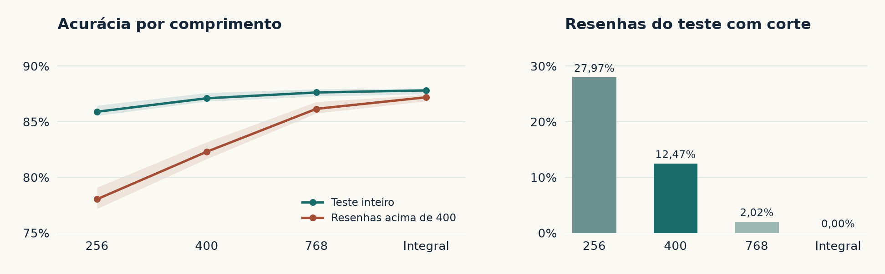

# Novos ensaios da TextCNN

## O efeito de treinar com mais texto

Na receita original, os 400 tokens foram um teto de custo. A primeira
configuração já usava esse valor, sem uma busca de comprimentos registrada.
No novo ensaio, aplicamos a mesma receita de treino aos limites de 256, 400
e 768 tokens por palavras e ao texto integral.

Usamos as divisões originais, com 19.823 resenhas de treino, 2.478 de
validação, 2.478 de calibração e 25.000 de teste. Cada configuração tem três
sementes pareadas (17, 29 e 42). Mantivemos vocabulário, ordem dos
minibatches, tamanho de lote 64, AdamW a 0,001 e oito épocas por treino.
Dentro da mesma arquitetura, a inicialização também é pareada. Selecionamos
por CE de validação e congelamos os checkpoints antes de avaliar o teste
e ajustar a temperatura. A referência de 400 é o novo treino, comparável
às variantes. O resultado histórico de 86,78% veio de cinco épocas,
seleção por F1 de validação e outro ambiente.

| Entrada com máximo global | Resenhas cortadas no teste | Tokens mantidos | Acurácia | Acurácia acima de 400 tokens | Tempo médio de treino |
|---|---:|---:|---:|---:|---:|
| 256 tokens | 6.992 (27,97%) | 77,51% | 85,89% | 78,03% | 20,3 s |
| 400 tokens | 3.118 (12,47%) | 89,59% | 87,11% | 82,30% | 27,7 s |
| 768 tokens | 504 (2,02%) | 98,78% | 87,63% | 86,16% | 49,8 s |
| Texto integral | 0 | 100% | 87,81% | 87,19% | 58,7 s |

As faixas do gráfico vão do mínimo ao máximo das três sementes.

O subconjunto longo tem as mesmas 3.118 resenhas nas quatro linhas. Entre
400 e texto integral, o ganho foi de 0,71 ponto no teste todo e 4,90 nas
longas. O teto de 768 chega a 98,78% dos tokens, a 0,19 ponto da acurácia
integral. As diferenças foram calculadas antes de arredondar. Os tempos
somam as oito épocas e excluem a avaliação. A maior
resenha do teste tem 2.247 tokens. A rede aceita comprimentos variáveis e
o padding segue a maior sequência de cada lote. No treino, 400 recortou
2.621 resenhas (13,22%). A versão integral requer mais cálculo.

As métricas abaixo são médias das três sementes. A CE do teste usa
temperatura ajustada separadamente para cada execução.

| Alteração | Validação, CE bruta | Teste, acurácia | Teste, F1 macro | Teste, CE |
|---|---:|---:|---:|---:|
| Máximo global, 400 | 0,2858 | 87,11% | 0,8710 | 0,3022 |
| Máximo global, integral | 0,2657 | 87,81% | 0,8781 | 0,2884 |
| Máximo + média, 400 | 0,2728 | 87,53% | 0,8753 | 0,2958 |
| Máximo + média, integral | 0,2602 | 88,18% | 0,8817 | 0,2860 |
| Máximo por metade, 400 | 0,2857 | 86,85% | 0,8685 | 0,3060 |
| Janelas 3/5/7, 400 | 0,3007 | 86,87% | 0,8687 | 0,3090 |
| Convoluções residuais dilatadas + máximo e média, 400 | 0,2866 | 86,55% | 0,8651 | 0,3065 |
| Máximo global sem decaimento, 400 | 0,2811 | 87,08% | 0,8708 | 0,3016 |
| Máximo global com dropout 0,2, 400 | 0,2749 | 87,70% | 0,8770 | 0,2867 |

Máximo + média entrega, para cada filtro, o pico e a resposta média nas
janelas válidas. A camada final recebe 600 atributos. Ela ganhou 0,37
ponto sobre o máximo no texto integral. O resumo ainda é invariante à
ordem das janelas. A rede dilatada amplia o campo receptivo antes de
resumir. A variante 3/5/7 mantém cem filtros por largura e aumenta o
número de pesos nas convoluções. Reduzir dropout de 0,5 a 0,2 acrescentou
0,60 ponto com limite de 400. Tirar o decaimento de 0,01 mudou −0,02 ponto.
O texto integral, máximo + média e dropout de 0,2 ganharam nas três
sementes de suas respectivas comparações. A melhor média ficou em 88,18%,
ante os 90,14% do TF-IDF original.

Avaliamos também 128 pares sintéticos com veredito no fim e 128 com
veredito no início. O máximo global a 400 acertou 0% e 80,47% dos pares,
respectivamente. A versão dilatada obteve 9,64% e 42,45%. Ela acertou mais
pares com veredito no fim, com variação de 1,56% a 21,88% entre sementes e
perda com o veredito no início. A amostra humana desse ensaio ficou em
apenas dois pares após remover versões presentes nas divisões de ajuste
ou com o mesmo prefixo de IDs. Por isso o ensaio de ordem usa a avaliação
interna abaixo.

O teste oficial já tinha sido consultado durante o projeto. Essas
comparações são exploratórias. As médias de três sementes medem a
sensibilidade às inicializações usadas e compartilham as mesmas resenhas.

[Métricas por semente](../results/cnn_length/summary.json) ·
[Protocolo](../results/cnn_length/protocol.json) ·
[Épocas escolhidas](../results/cnn_length/selection.json) ·
[Margens pareadas](../results/cnn_length/predictions.npz).

## Robustez com os pares reservados

Repetimos o treino com a divisão interna usada para estudar pooling.
São 6.144 resenhas de treino, 1.536 de validação, 2.048 na auditoria
comum e os mesmos 344 pares editados por pessoas. Verificamos que nenhuma
versão dos pares compartilha os IDs de um texto de treino ou validação
com a entrada de cada receita. Preservamos o vocabulário por palavras
treinado nessa divisão. As cinco variantes usam três sementes, AdamW
e a mesma seleção de época por perda de validação.

| Entrada e pooling | Auditoria comum | Pares humanos | Veredito no fim | Veredito no início |
|---|---:|---:|---:|---:|
| 128 palavras, máximo global | 77,99% | 36,34% | 1,04% | 51,30% |
| Texto integral, máximo global | 83,94% | 43,41% | 0,00% | 57,29% |
| Texto integral, máximo + média | 85,56% | 39,83% | 0,00% | 70,05% |
| Texto integral, máximo por metade | 84,21% | 41,86% | 0,78% | 59,11% |
| Texto integral, convolução dilatada, máximo + média | 83,53% | 38,57% | 1,04% | 36,46% |

As três últimas colunas exigem acertar ambas as versões de cada par. O
texto inteiro melhorou a CNN com máximo global nos pares humanos em
7,07 pontos em relação ao prefixo de 128 palavras. Entre as variantes
que leem o texto inteiro, nenhuma alternativa ao máximo global ganhou
nos pares humanos, apesar de máximo + média ter vencido na auditoria comum.
Com veredito no fim, todas ficaram entre 0% e 1,04%. Os 344 pares editados
incluem mudanças que vão além da ordem. A troca de adjetivos nos moldes
sintéticos testa a ordem diretamente.
[Predições](../results/cnn_order_full/predictions.npz) ·
[Resultados por semente](../results/cnn_order_full/summary.json) ·
[Protocolo](../results/cnn_order_full/protocol.json).

## Embeddings pré-treinados

Comparamos a mesma TextCNN de máximo global, texto integral e embeddings
de 100 dimensões em três condições. Na primeira, a tabela começa
aleatória. Na segunda, usamos os vetores GloVe para as palavras cobertas,
com as correspondências embaralhadas. Na terceira, cada vetor GloVe vai
para a palavra certa. Os vetores cobriram 19.243 das 19.998 entradas
lexicais. As entradas sem vetor mantêm a inicialização aleatória pareada,
e os embeddings são ajustados durante o treino em todos os casos.

| Inicialização | Teste oficial | F1 macro | CE calibrada | Resenhas acima de 400 tokens |
|---|---:|---:|---:|---:|
| Aleatória | 87,49% | 0,8748 | 0,2967 | 85,94% |
| GloVe embaralhado | 87,63% | 0,8762 | 0,2943 | 85,83% |
| GloVe | 87,83% | 0,8783 | 0,2899 | 87,77% |

O ganho do GloVe foi de 0,34 ponto sobre a inicialização aleatória e
0,20 sobre os vetores embaralhados no teste inteiro. A ordem entre as
condições variou por semente. O pré-treino testado é de vetores estáticos,
com o mesmo vetor inicial para uma palavra em qualquer contexto. Os
controles com 100 dimensões são a referência para medir o efeito do GloVe.
[Vetores publicados por Stanford](https://huggingface.co/stanfordnlp/glove/blob/main/glove.6B.zip) ·
[Artigo GloVe](https://aclanthology.org/D14-1162/) ·
[Métricas](../results/cnn_embeddings/summary.json) ·
[Protocolo](../results/cnn_embeddings/protocol.json).

## Reproduzir

Prepare as divisões originais conforme o [guia de reprodução](../docs/REPRODUCAO.md).
Os TSV do [IMDb Contrast Sets](https://github.com/allenai/contrast-sets/tree/e2b87316ba7b30093bc9ffbc340e6550cab79f67/IMDb/data)
devem estar no diretório indicado. Use diretórios novos para os resultados.

~~~bash
export PYTHONPATH=src
python seminario/treinar_cnn_comprimento.py train --data data --output tmp/cnn_length
python seminario/treinar_cnn_comprimento.py audit --data data --output tmp/cnn_length --contrast-dir /caminho/contrast
python seminario/treinar_cnn_pares.py --data data --output tmp/cnn_pairs --contrast-dir /caminho/contrast
python seminario/treinar_cnn_embeddings.py --data data --output tmp/cnn_embeddings --glove /caminho/glove.6B.zip
~~~
