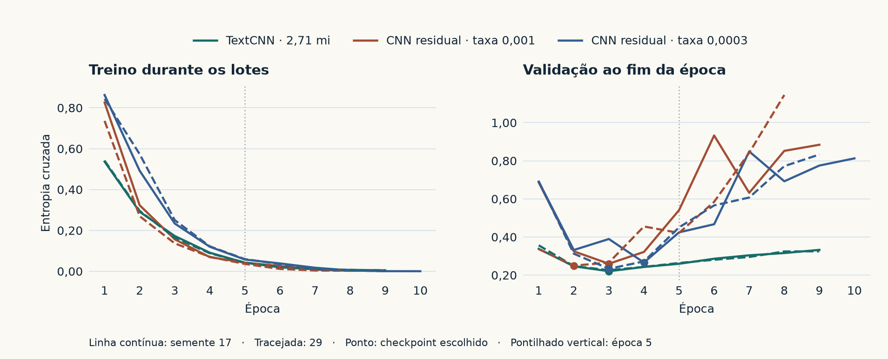

# Novos ensaios da TextCNN

Os primeiros 93 treinos comparam comprimento, arquitetura, representação,
regularização e robustez à ordem. A variante de pooling escolhida na
validação daquele ensaio fez 88,13% no teste com 768 tokens e máximo
suave. Nos pares humanos, a maior média foi de uma CNN com texto
integral e máximo global. A comparação seguinte estuda uma [CNN maior
com orçamento de treino ampliado](#uma-cnn-maior-e-mais-épocas-ajudam).

## O efeito de treinar com mais texto

Na receita original, os 400 tokens foram um teto de custo. A primeira
configuração já usava esse valor, sem uma busca de comprimentos registrada.
No novo ensaio, aplicamos a mesma receita de treino aos limites de 256, 400
e 768 tokens por palavras e ao texto integral.

Usamos as divisões originais, com 19.823 resenhas de treino, 2.478 de
validação, 2.478 de calibração e 25.000 de teste. Cada configuração tem três
sementes pareadas (17, 29 e 42). Mantivemos vocabulário, ordem dos
minibatches, tamanho de lote 64, AdamW a 0,001 e oito épocas por treino.
Dentro da mesma arquitetura, a inicialização também é pareada. Selecionamos
por CE de validação e congelamos os checkpoints antes de avaliar o teste
e ajustar a temperatura. A referência de 400 é o novo treino, comparável
às variantes. O resultado histórico de 86,78% veio de cinco épocas,
seleção por F1 de validação e outro ambiente.

| Entrada com máximo global | Resenhas cortadas no teste | Tokens mantidos | Acurácia | Acurácia acima de 400 tokens | Tempo médio de treino |
|---|---:|---:|---:|---:|---:|
| 256 tokens | 6.992 (27,97%) | 77,51% | 85,89% | 78,03% | 20,3 s |
| 400 tokens | 3.118 (12,47%) | 89,59% | 87,11% | 82,30% | 27,7 s |
| 768 tokens | 504 (2,02%) | 98,78% | 87,63% | 86,16% | 49,8 s |
| Texto integral | 0 | 100% | 87,81% | 87,19% | 58,7 s |

As faixas do gráfico vão do mínimo ao máximo das três sementes.

O subconjunto longo tem as mesmas 3.118 resenhas nas quatro linhas. Entre
400 e texto integral, o ganho foi de 0,71 ponto no teste todo e 4,90 nas
longas. O teto de 768 chega a 98,78% dos tokens, a 0,19 ponto da acurácia
integral. As diferenças foram calculadas antes de arredondar. Os tempos
somam as oito épocas e excluem a avaliação. A maior
resenha do teste tem 2.247 tokens. A rede aceita comprimentos variáveis e
o padding segue a maior sequência de cada lote. No treino, 400 recortou
2.621 resenhas (13,22%). A versão integral requer mais cálculo.

As métricas abaixo são médias das três sementes. A CE do teste usa
temperatura ajustada separadamente para cada execução.

| Alteração | Validação, CE bruta | Teste, acurácia | Teste, F1 macro | Teste, CE |
|---|---:|---:|---:|---:|
| Máximo global, 400 | 0,2858 | 87,11% | 0,8710 | 0,3022 |
| Máximo global, integral | 0,2657 | 87,81% | 0,8781 | 0,2884 |
| Máximo + média, 400 | 0,2728 | 87,53% | 0,8753 | 0,2958 |
| Máximo + média, integral | 0,2602 | 88,18% | 0,8817 | 0,2860 |
| Máximo por metade, 400 | 0,2857 | 86,85% | 0,8685 | 0,3060 |
| Janelas 3/5/7, 400 | 0,3007 | 86,87% | 0,8687 | 0,3090 |
| Convoluções residuais dilatadas + máximo e média, 400 | 0,2866 | 86,55% | 0,8651 | 0,3065 |
| Máximo global sem decaimento, 400 | 0,2811 | 87,08% | 0,8708 | 0,3016 |
| Máximo global com dropout 0,2, 400 | 0,2749 | 87,70% | 0,8770 | 0,2867 |

Máximo + média entrega, para cada filtro, o pico e a resposta média nas
janelas válidas. A camada final recebe 600 atributos. Ela ganhou 0,37
ponto sobre o máximo no texto integral. O resumo ainda é invariante à
ordem das janelas. A rede dilatada amplia o campo receptivo antes de
resumir. A variante 3/5/7 mantém cem filtros por largura e aumenta o
número de pesos nas convoluções. Reduzir dropout de 0,5 a 0,2 acrescentou
0,60 ponto com limite de 400. Tirar o decaimento de 0,01 mudou −0,02 ponto.
O texto integral, máximo + média e dropout de 0,2 ganharam nas três
sementes de suas respectivas comparações. A melhor média ficou em 88,18%,
ante os 90,14% do TF-IDF original.

Avaliamos também 128 pares sintéticos com veredito no fim e 128 com
veredito no início. O máximo global a 400 acertou 0% e 80,47% dos pares,
respectivamente. A versão dilatada obteve 9,64% e 42,45%. Ela acertou mais
pares com veredito no fim, com variação de 1,56% a 21,88% entre sementes e
perda com o veredito no início. A amostra humana desse ensaio ficou em
apenas dois pares após remover versões presentes nas divisões de ajuste
ou com o mesmo prefixo de IDs. Por isso o ensaio de ordem usa a avaliação
interna abaixo.

O teste oficial já tinha sido consultado durante o projeto. Essas
comparações são exploratórias. As médias de três sementes medem a
sensibilidade às inicializações usadas e compartilham as mesmas resenhas.

[Métricas por semente](../results/cnn_length/summary.json) ·
[Protocolo](../results/cnn_length/protocol.json) ·
[Épocas escolhidas](../results/cnn_length/selection.json) ·
[Margens pareadas](../results/cnn_length/predictions.npz).

## Robustez com os pares reservados

Repetimos o treino com a divisão interna usada para estudar pooling.
São 6.144 resenhas de treino, 1.536 de validação, 2.048 na auditoria
comum e os mesmos 344 pares editados por pessoas. Verificamos que nenhuma
versão dos pares compartilha os IDs de um texto de treino ou validação
com a entrada de cada receita. Preservamos o vocabulário por palavras
treinado nessa divisão. As cinco variantes usam três sementes, AdamW
e a mesma seleção de época por perda de validação.

| Entrada e pooling | Auditoria comum | Pares humanos | Veredito no fim | Veredito no início |
|---|---:|---:|---:|---:|
| 128 palavras, máximo global | 77,99% | 36,34% | 1,04% | 51,30% |
| Texto integral, máximo global | 83,94% | 43,41% | 0,00% | 57,29% |
| Texto integral, máximo + média | 85,56% | 39,83% | 0,00% | 70,05% |
| Texto integral, máximo por metade | 84,21% | 41,86% | 0,78% | 59,11% |
| Texto integral, convolução dilatada, máximo + média | 83,53% | 38,57% | 1,04% | 36,46% |

As três últimas colunas exigem acertar ambas as versões de cada par. O
texto inteiro melhorou a CNN com máximo global nos pares humanos em
7,07 pontos em relação ao prefixo de 128 palavras. Entre as variantes
que leem o texto inteiro, nenhuma alternativa ao máximo global ganhou
nos pares humanos, apesar de máximo + média ter vencido na auditoria comum.
Com veredito no fim, todas ficaram entre 0% e 1,04%. Os 344 pares editados
incluem mudanças que vão além da ordem. A troca de adjetivos nos moldes
sintéticos testa a ordem diretamente.
[Predições](../results/cnn_order_full/predictions.npz) ·
[Resultados por semente](../results/cnn_order_full/summary.json) ·
[Protocolo](../results/cnn_order_full/protocol.json).

## Embeddings pré-treinados

Comparamos a mesma TextCNN de máximo global, texto integral e embeddings
de 100 dimensões em três condições. Na primeira, a tabela começa
aleatória. Na segunda, usamos os vetores GloVe para as palavras cobertas,
com as correspondências embaralhadas. Na terceira, cada vetor GloVe vai
para a palavra certa. Os vetores cobriram 19.243 das 19.998 entradas
lexicais. As entradas sem vetor mantêm a inicialização aleatória pareada,
e os embeddings são ajustados durante o treino em todos os casos.

| Inicialização | Teste oficial | F1 macro | CE calibrada | Resenhas acima de 400 tokens |
|---|---:|---:|---:|---:|
| Aleatória | 87,49% | 0,8748 | 0,2967 | 85,94% |
| GloVe embaralhado | 87,63% | 0,8762 | 0,2943 | 85,83% |
| GloVe | 87,83% | 0,8783 | 0,2899 | 87,77% |

O ganho do GloVe foi de 0,34 ponto sobre a inicialização aleatória e
0,20 sobre os vetores embaralhados no teste inteiro. O GloVe superou a
inicialização aleatória nas três sementes, e o embaralhado o superou em
uma. O pré-treino testado é de vetores estáticos,
com o mesmo vetor inicial para uma palavra em qualquer contexto. Os
controles com 100 dimensões são a referência para medir o efeito do GloVe.
[Vetores publicados por Stanford](https://huggingface.co/stanfordnlp/glove/blob/main/glove.6B.zip) ·
[Artigo GloVe](https://aclanthology.org/D14-1162/) ·
[Métricas](../results/cnn_embeddings/summary.json) ·
[Protocolo](../results/cnn_embeddings/protocol.json).

## Treino com exemplos contrastivos

A CNN pode aprender a seguir o veredito quando recebe exemplos em que a
ordem faz diferença? Acrescentamos 768 frases sintéticas em 384 pares
balanceados a 6.144 resenhas de treino. Em cada par, dois adjetivos
trocam de lugar e o rótulo segue a oração que contém o veredito. Usamos
seis moldes e 16 adjetivos diferentes dos da avaliação sintética. No
controle, repetimos 768 resenhas do próprio treino, com as mesmas
contagens de classe, número de passos e ordem dos índices. O vocabulário
permanece o da divisão interna. A validação de resenhas comuns escolhe a
época antes da avaliação. Cada linha é a média de três sementes.

| Arquitetura e treino | Auditoria comum | Pares humanos | Veredito no fim | Veredito no início |
|---|---:|---:|---:|---:|
| Máximo global, repetição | 84,07% | 43,80% | 0,52% | 67,19% |
| Máximo global, contrastes | 83,87% | 43,22% | 0,78% | 54,95% |
| CNN dilatada, repetição | 84,20% | 41,86% | 5,47% | 30,21% |
| CNN dilatada, contrastes | 83,79% | 41,28% | 1,30% | 32,29% |

Com o máximo global, a variação no veredito no fim equivale a um par
correto a mais somando as três sementes. Nos pares humanos, as duas
arquiteturas perderam 0,58 ponto na média. O ensaio mede transferência
destes exemplos para outros moldes e para edições humanas. As frases
sintéticas e as resenhas repetidas diferem em comprimento e estilo.
[Protocolo e moldes](../results/cnn_order_training/protocol.json) ·
[Resultados por semente](../results/cnn_order_training/summary.json) ·
[Margens](../results/cnn_order_training/predictions.npz).

## O que muda ao trocar só o pooling?

Em 24 treinos, mantivemos as convoluções de larguras 3, 4 e 5, os mesmos
IDs, os mesmos 300 valores na entrada da camada final e 2.714.502
parâmetros em cada execução. Cada receita usa as sementes 17, 29 e 42
com inicialização e minibatches pareados. Rodamos oito épocas com AdamW,
taxa 0,001, lote 64, dropout 0,5 e decaimento 0,01, exceto nas linhas
que alteram a regularização. As épocas e a receita foram escolhidas pela
menor entropia cruzada bruta de validação, antes da nova avaliação no
teste oficial e nos pares sintéticos. Ambos os conjuntos já tinham
sido usados no projeto.

O máximo suave guarda um valor por filtro e dá mais peso às ativações
altas. Calculamos \(s=\tau\log(\sum_t w_t\exp(a_t/\tau)/\sum_t w_t)\),
com \(\tau=0{,}5\) e soma só nas janelas válidas. Com \(w_t=1\), a
ordem das janelas fica descartada. Para testar posição com o mesmo
número de valores, aumentamos \(w_t\) de 1 no início a 3 no fim.

| Receita | CE de validação | Acurácia no teste | F1 macro | Pares com veredito no fim |
|---|---:|---:|---:|---:|
| Máximo, 400 tokens | 0,2858 | 87,11% | 0,8710 | 0/384 |
| Máximo suave, 400 tokens | 0,2692 | 87,71% | 0,8769 | 0/384 |
| Máximo, 768 tokens | 0,2703 | 87,63% | 0,8763 | 2/384 |
| Máximo suave, 768 tokens | **0,2585** | **88,13%** | **0,8812** | 1/384 |
| Média, 768 tokens | 0,2690 | 87,45% | 0,8745 | 0/384 |
| Máximo suave com peso no fim, 768 tokens | 0,2585 | 88,28% | 0,8826 | 4/384 |
| Máximo, 768 tokens, dropout 0,2 | 0,2632 | 87,53% | 0,8752 | 1/384 |
| Máximo, 768 tokens, decaimento 0,1 | 0,2622 | 87,90% | 0,8789 | 0/384 |

As métricas do IMDb são médias das três sementes. A última coluna soma
os acertos nas três avaliações dos mesmos 128 pares. Para um par contar,
ambos os textos precisam ser classificados corretamente. Na validação,
a CE média sem peso posicional foi 0,258467 e a com peso no fim 0,258514.
A diferença arredonda para zero na tabela.

Com 400 tokens, o máximo suave ganhou 0,60 ponto no teste. Com 768,
ganhou 0,51. As duas diferenças tiveram o mesmo sinal nas três sementes.
Isso mede o efeito de mudar a agregação mantendo a capacidade da cabeça.
O ganho ficou bem aquém da diferença para o TF-IDF. Dar mais peso ao fim
levou o acerto de dois a quatro em 384 avaliações de pares com veredito
no fim e reduziu de 79,69% para 72,66% o acerto com veredito no início,
em ambos os casos comparado ao máximo em 768.
O ganho médio em resenhas comuns coexistiu com baixa robustez à ordem
nesses moldes. O ensaio não estima uma parcela única do erro atribuível
ao pooling, pois o efeito depende da agregação e do comprimento escolhidos.

Aumentar o decaimento de 0,01 para 0,1 acrescentou 0,27 ponto para a
CNN de máximo no teste. Reduzir dropout para 0,2 elevou a acurácia de
treino de 95,87% para 97,38% e variou −0,09 ponto no teste. A diferença
entre treino e teste, por si só, não indica qual dos dois ajustes ajuda.
[Protocolo](../results/cnn_pooling_matched/protocol.json) ·
[Seleção na validação](../results/cnn_pooling_matched/selection.json) ·
[Métricas por semente](../results/cnn_pooling_matched/summary.json) ·
[Margens](../results/cnn_pooling_matched/predictions.npz).

## Uma CNN maior e mais épocas ajudam?

Treinamos uma TextCNN de **2.714.502 parâmetros** e uma CNN residual
piramidal de **11.126.914**, ambas do zero, com o mesmo vocabulário por
palavras e o texto inteiro. A residual tem embedding de 256 dimensões,
384 canais, seis blocos com duas convoluções cada e conexões residuais.
A cada bloco, um máximo local com passo 2 encurta a sequência. A
camada final usa máximo e média globais com máscara. O maior tamanho
vem tanto dos embeddings quanto das convoluções. O desenho piramidal
aproveita a ideia de ampliar o contexto com convoluções empilhadas e
reduzir o custo das camadas posteriores. [Johnson e Zhang, 2017](https://aclanthology.org/P17-1052/)

Usamos os 19.823 exemplos de treino e os 2.478 de validação do estudo
original, sementes 17 e 29, lote 64, AdamW e a NVIDIA GB10 da DGX Spark.
A ordem dos lotes foi pareada entre as receitas. Agrupamos
comprimentos parecidos para reduzir padding. Os pesos e o otimizador
ficam em FP32. As passagens usam BF16 em CUDA. Na rodada inicial, as
duas arquiteturas começaram com taxa 0,001. Em uma segunda rodada,
repetimos essas duas e adicionamos a residual a 0,0003, motivados pela
trajetória da perda de validação da residual inicial. Dentro de cada
semente, as duas taxas da residual partem dos mesmos pesos.

A taxa cai pela metade após o platô de validação definido no protocolo.
O orçamento permite até 30 épocas e cerca de 11 minutos por treino.
Paramos após seis épocas sem melhora de pelo menos 0,001 na entropia
cruzada de validação, a partir da oitava. Guardamos a menor perda de
validação até a quinta época e ao longo do treino completo. Depois de
congelar esses checkpoints, ajustamos a temperatura e abrimos o teste.
O teste oficial já foi consultado durante o projeto, então o resultado
da nova rodada é exploratório.

| Receita com texto inteiro | Parâmetros | Épocas escolhidas / rodadas (17, 29) | Tempo médio por treino | Acurácia | F1 macro | CE calibrada | Acurácia acima de 400 tokens |
|---|---:|---|---:|---:|---:|---:|---:|
| TextCNN, taxa 0,001 | 2,71 mi | 3/9, 3/9 | 24,4 s | 89,60% | 0,8960 | 0,2529 | 88,28% |
| CNN residual, taxa 0,001 | 11,13 mi | 3/9, 2/8 | 72,1 s | 88,07% | 0,8803 | 0,2831 | 86,23% |
| CNN residual, taxa 0,0003 | 11,13 mi | 4/10, 3/9 | 77,4 s | 88,37% | 0,8836 | 0,2777 | 87,65% |

Acurácia, F1 e CE são médias das métricas de dois modelos, um por
semente, nas mesmas 25.000 resenhas. A última coluna usa as mesmas
3.118 resenhas que seriam cortadas a 400 tokens. O tempo inclui
treino, validação e gravação dos pesos ao longo das épocas rodadas.
Os seis treinos da segunda rodada somaram **5 min 48 s**, sem contar
a preparação de dados e o teste. As duas receitas repetidas
reproduziram exatamente as métricas da primeira rodada.

Os seis treinos pararam por falta de progresso na validação entre
as épocas 8 e 10. Em todos, o melhor checkpoint até a quinta época
é o mesmo de toda a execução. Na semente 29 da residual a 0,001, a
CE de validação vai de **0,250** na melhor época a **1,145** no fim,
quando o modelo acerta quase todos os exemplos durante os lotes de
treino. Isso é evidência de sobreajuste nessa receita. Reduzir a taxa
da residual melhorou a média do teste em **0,30 ponto percentual**,
com ganho na semente 17 e perda na 29. A TextCNN ficou à frente
das duas receitas residuais nas duas sementes.

A TextCNN com texto inteiro chegou a **89,60%**, a **0,54 ponto**
do TF-IDF original (**90,14%**). Em relação à CNN original de
**86,78%**, mudaram juntos comprimento, inicialização, dropout,
ordem dos lotes, precisão e regra de seleção do checkpoint. A
comparação que isola duração é dentro de cada treino. A comparação
entre arquiteturas a 0,001 mantém dados, lotes e receita, e testa
o conjunto de mudanças da residual, incluindo profundidade e
pooling. A hipótese de limitação pelo tamanho do corpus exigiria
uma curva com diferentes quantidades de resenhas de treino.

[Protocolo](../results/cnn_maior/protocol.json) ·
[Curvas e épocas por semente](../results/cnn_maior/selection.json) ·
[Métricas](../results/cnn_maior/summary.json) ·
[Margens e rótulos](../results/cnn_maior/predictions.npz).

## Reproduzir

Prepare as divisões originais conforme o [guia de reprodução](../docs/REPRODUCAO.md).
Os TSV do [IMDb Contrast Sets](https://github.com/allenai/contrast-sets/tree/e2b87316ba7b30093bc9ffbc340e6550cab79f67/IMDb/data)
devem estar no diretório indicado. Use diretórios novos para os resultados.

~~~bash
export PYTHONPATH=src
python seminario/treinar_cnn_comprimento.py train --data data --output tmp/cnn_length
python seminario/treinar_cnn_comprimento.py audit --data data --output tmp/cnn_length --contrast-dir /caminho/contrast
python seminario/treinar_cnn_pares.py --data data --output tmp/cnn_pairs --contrast-dir /caminho/contrast
python seminario/treinar_cnn_embeddings.py --data data --output tmp/cnn_embeddings --glove /caminho/glove.6B.zip
python seminario/treinar_cnn_ordem_supervisionada.py --data data --output tmp/cnn_order --contrast-dir /caminho/contrast
python seminario/medir_pooling_regularizacao.py cnn --data data --output tmp/cnn_pooling_matched
python seminario/medir_pooling_regularizacao.py baseline --data data --output tmp/tfidf_regularization
python seminario/plotar_ensaios_cnn.py
python seminario/treinar_cnn_maior.py train --data data --output tmp/cnn_maior
python seminario/treinar_cnn_maior.py audit --data data --output tmp/cnn_maior
python seminario/plotar_cnn_maior.py
~~~
